# PAnkxProxy-v.03.0.6

**Enterprise Universal AI Router, Frontier Model Unlocker, Cross-Platform Session Hub & Autonomous Generative Media Studio**

[]()
[]()
[]()
[]()

---

## 1. Executive Overview

**PAnkxProxy-v.03.0.6** is a unified, high-availability AI infrastructure platform engineered to eliminate rate limits, decouple models from restrictive consumer subscription tiers, bridge conversational history across disparate AI platforms, and provide an autonomous generative media synthesis engine.

### Core Architecture Pillars:
1. **Universal AI Router & Same-Model Cascade Matrix (IMRCM):** When an upstream provider returns HTTP 429 (Rate Limit), HTTP 402 (Quota Exhaustion), or connection timeout, PAnkxProxy automatically switches to the **exact same model** hosted on alternate providers before degrading to peer models.
2. **Arena H100 Dedicated GPU Cluster:** High-performance HTTP/2 warm connection pool with Cloudflare Error 1010 bypass headers, intelligent 402 paid credit interception, and sub-second execution latencies.
3. **Cross-Platform Session Hub:** Full bi-directional session routing where conversations created on **Claude** are instantly visible, switchable, and interactive under **ChatGPT**, **Arena.AI**, and **OpenRouter** with zero conversational amnesia.
4. **Universal Model Unlocker:** Zero-tier artificial gating—direct programmatic access to 19+ powerhouse frontier reasoning and coding models.
5. **Zero-Cost Keep-Alive Daemon:** Non-billable background prober keeping TLS sockets pre-warmed ($0.00 cost) to eliminate cold starts.
6. **Autonomous Generative Media Studio:** Integrated 1080×1920 vertical scene synthesis (Pollinations Flux, fal.ai Kling/Seedance/MiniMax, Google Veo 3) and FFmpeg cinematic camera motion clips, exporting completed media locally and delivering via Telegram and REST API.

---

## 2. System Architecture

```mermaid
flowchart TD
    CLIENTS["Clients & Consoles (Web UI, Telegram, REST API, IDEs)"] --> GATEWAY["Gateway Reverse Proxy :8080"]

    subgraph HUB["Cross-Platform Session Hub & Store"]
        GATEWAY --> SESS_ROUTER["Session Router (/v1/sessions)"]
        SESS_ROUTER --> SQLITE_STORE[("Central SQLite Store\nconversations + messages")]
        SESS_ROUTER --> CONV_BRIDGE["Context Bridge & Schema Normalizer\n(Anthropic <--> OpenAI <--> DeepSeek <think>)"]
    end

    subgraph ROUTER["PAnkxProxy Multi-Provider Cascade Matrix (IMRCM)"]
        GATEWAY --> OMNI["OmniRoute Engine"]
        OMNI -->|Tier 1: Dedicated GPU| ARENA["Arena H100 Cluster\n(Warm HTTP/2 + Cloudflare Bypass)"]
        OMNI -->|Tier 2: Direct API| ANTHROPIC["Anthropic Claude Console"]
        OMNI -->|Tier 2: Direct API| OPENAI["OpenAI Direct / ChatGPT"]
        OMNI -->|Tier 3: Aggregator| OPENROUTER["OpenRouter Free & Frontier Matrix"]
        OMNI -->|Tier 4: Ultra-Low Latency| GROQ["Groq LPU (Llama 3.3 70B)"]
        OMNI -->|Tier 5: Serverless| DEEPINFRA["DeepInfra Inference"]
    end

    subgraph STUDIO["Autonomous Generative Media Studio"]
        GATEWAY --> MEDIA_ENG["Generative Media Engine"]
        MEDIA_ENG --> FLUX["Pollinations Flux (1080x1920 Free)"]
        MEDIA_ENG --> MOTION["FFmpeg Cinematic Motion (Zoompan)"]
        MEDIA_ENG --> FAL["fal.ai (Kling AI, Seedance, MiniMax)"]
        MEDIA_ENG --> VEO["Google Cloud Vertex (Veo 3)"]
        MEDIA_ENG --> TTS["Edge-TTS / Whisper Neural Audio"]
        MEDIA_ENG --> OUTPUT[("Local Output: output/videos/\n+ Direct Telegram Push")]
    end
```



---

## 3. Directory Layout

```
shorts-agent/
├── agent/
│   ├── main.py                     # Master CLI dispatcher
│   ├── config/
│   │   ├── paid_router_config.json # Enterprise workspace & router profiles
│   │   └── hook_rules.md           # Scriptwriting & attention guidelines
│   ├── modules/
│   │   ├── omniroute_embedded.py   # Multi-router cascade & same-model failover matrix
│   │   ├── arena_cluster.py        # Arena H100 warm HTTP/2 connection pool
│   │   ├── capability_registry.py  # Model freedom catalog (19 unlocked models)
│   │   ├── session_router.py       # Cross-platform session hub (Claude/ChatGPT/Arena)
│   │   ├── sessions_ui.py          # Interactive Web Console for /sessions
│   │   ├── gateway_server.py       # OpenAI & Anthropic reverse proxy (:8080)
│   │   ├── conversation_store.py   # Lossless message normalizer & <think> isolation
│   │   ├── db.py                   # Central SQLite conversation & run storage
│   │   ├── keep_alive.py           # Zero-cost TLS socket warming daemon
│   │   ├── generative_media.py     # Flux scene & FFmpeg motion synthesis
│   │   ├── anthropic_adapter.py    # Direct Anthropic Console adapter
│   │   ├── openai_adapter.py       # Direct OpenAI / reasoning adapter
│   │   ├── telegram_control.py     # Telegram bot handler & operator command set
│   │   └── render.py               # FFmpeg compositor & audio ducking
│   └── state/                      # SQLite persistence (db.sqlite)
├── archive/
│   └── legacy_youtube_cluster/     # Decommissioned YouTube OAuth & scraping cluster
├── tests/
│   ├── e2e/                        # 260-test 4-Tier end-to-end regression suite
│   ├── unit/                       # Unit tests for adapters, cluster, registry
│   ├── test_session_router.py      # Cross-platform session routing tests
│   ├── test_conversation_store.py  # Schema normalization & thinking isolation tests
│   └── test_gateway_server.py      # Gateway endpoint verification
├── run_e2e_tests.py                # Master 4-Tier test runner
├── CHECKPOINT.md                   # Real-time synchronization log
└── README.md
```

---

## 4. Key Subsystems & Features

### 4.1 Same-Model Priority Failover (IMRCM)
When an upstream provider triggers HTTP 429, 402, or timeout, PAnkxProxy preserves the exact requested model by querying alternative hosts in priority sequence:
- **`claude-3-5-sonnet`**: Arena H100 Cluster $\rightarrow$ Anthropic Direct Console $\rightarrow$ OpenRouter $\rightarrow$ Opencode.
- **`claude-3-7-sonnet`**: Arena H100 Cluster $\rightarrow$ Anthropic Direct Console $\rightarrow$ OpenRouter.
- **`gpt-4o`**: OpenAI Direct $\rightarrow$ OpenRouter $\rightarrow$ Arena.
- **`o1` / `o3-mini`**: OpenAI Direct $\rightarrow$ OpenRouter.
- **`llama-3.3-70b`**: Groq Direct $\rightarrow$ OpenRouter $\rightarrow$ DeepInfra.
- **`deepseek-r1` / `deepseek-v3`**: OpenRouter $\rightarrow$ DeepInfra $\rightarrow$ Arena.

### 4.2 Cross-Platform Session Hub
- **Universal Visibility:** Sessions created on Claude can be queried, continued, and managed on ChatGPT, Arena.AI, and OpenRouter.
- **Lossless Normalization:** Converts provider wire formats dynamically:
  - DeepSeek `<think>` reasoning traces isolated into dedicated database fields.
  - Anthropic consecutive user/assistant turn merging and developer-role translation.
  - OpenAI developer role vs. standard system role auto-resolution.
- **Web Console:** Built-in interactive dashboard served at `http://localhost:8080/sessions` for one-click platform re-routing and turn inspection.

### 4.3 Universal Model Unlocker (19 Models)
| Model Canonical ID | Provider Routes | Context Window | Capabilities |
| :--- | :--- | :--- | :--- |
| `claude-3-7-sonnet` | Arena, Anthropic, OpenRouter | 200,000 | Extended Thinking, Coding |
| `claude-3-5-sonnet` | Arena, Anthropic, OpenRouter | 200,000 | Vision, Advanced Coding |
| `coding-router-preview` | Arena Dedicated H100 | 128,000 | Enterprise Coding |
| `o1` | OpenAI Direct, OpenRouter | 200,000 | Deep Reasoning |
| `o3-mini` | OpenAI Direct, OpenRouter | 200,000 | Fast Reasoning |
| `gpt-4o` | OpenAI Direct, OpenRouter, Arena | 128,000 | Multimodal |
| `deepseek-r1` | OpenRouter, DeepInfra, Arena | 128,000 | Open Reasoning |
| `deepseek-v3` | OpenRouter, DeepInfra, Arena | 128,000 | 671B Mixture-of-Experts |
| `llama-3.1-405b` | OpenRouter, DeepInfra | 128,000 | Maximum Scale Open Model |
| `llama-3.3-70b` | Groq, OpenRouter, DeepInfra | 128,000 | Ultra-Low Latency |
| `gemini-2.0-flash` | OpenRouter, Gemini Direct | 1,000,000 | Real-Time Reasoning |
| `gemini-1.5-pro` | OpenRouter, Gemini Direct | 2,000,000 | Massive Context |

---

## 5. CLI & Service Usage

### Start Gateway Server & Web Console
```bash
python -m agent.main gateway 8080
```
- Interactive Web Console: `http://localhost:8080/sessions`
- OpenAI Compatible Chat: `POST http://localhost:8080/v1/chat/completions`
- Anthropic Compatible Messages: `POST http://localhost:8080/v1/messages`
- Sessions REST API: `GET/POST http://localhost:8080/v1/sessions`

### Cross-Platform Session CLI
```bash
# List all active sessions across Claude, ChatGPT, Arena
python -m agent.main sessions list

# Inspect full conversation turns of a session
python -m agent.main sessions show <session_id>

# Route an existing Claude session to ChatGPT with a specific model
python -m agent.main sessions route <session_id> chatgpt gpt-4o

# Send an interactive message to a routed session
python -m agent.main sessions send <session_id> "Refactor this function..."

# Export session transcript in standard JSON format
python -m agent.main sessions export <session_id> claude
```

### Autonomous Generative Video Production
```bash
# Generate video autonomously and save locally to output/videos/
python -m agent.main pipeline
```

### System Smoke Test & Verification
```bash
python -m agent.main smoke
```

---

## 6. Verification & Test Suite

Run the full 370-test suite across unit, cross-model history, and 4-tier E2E scenarios:

```bash
# Unit, session router & conversation store tests (110 tests)
pytest tests/unit/ tests/test_session_router.py tests/test_gateway_server.py tests/test_federation_registry.py tests/test_arena_cluster.py tests/test_challenger_m2_verification.py tests/test_omniroute_failover.py tests/test_model_freedom_v3.py tests/test_conversation_store.py tests/test_generative_media.py

# Master 4-Tier E2E test suite (260 tests)
python run_e2e_tests.py
```

**Status:** 370/370 Passed (100% Zero-Regression Guarantee).
