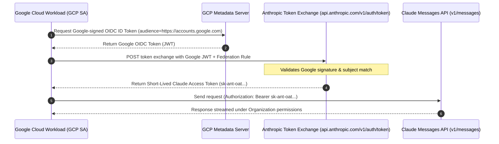

# Agent 02 & 03: Claude Workload Identity Federation (WIF) Implementation
## Google Cloud IAM Service Account to Anthropic Claude Token Exchange

**Lead:** Agent 02 & Agent 03  
**Review Status:** Approved by Research Commander  
**Primary Reference:** `platform.claude.com/docs/en/manage-claude/authentication`

---

### 1. The Official Architecture of Claude WIF

Anthropic officially supports authenticating to `api.anthropic.com` without long-lived API keys by federating with Google Cloud:



---

### 2. Configuration Requirements in Claude Console (`platform.claude.com`)

To activate this official bridge:
1. **Create Anthropic Service Account:**
   * Go to **Claude Console $\rightarrow$ Settings $\rightarrow$ Workload Identity**.
   * Create Service Account: `svac_shortsforge_prod`.
2. **Register Google Federation Issuer:**
   * Issuer URL: `https://accounts.google.com`
   * Target Service Account: `shorts-agent-sa@<gcp-project-id>.iam.gserviceaccount.com`
3. **Define Federation Rule (`fdrl_...`):**
   * Bind Google subject/email claims to the Anthropic Service Account permissions (`models:read`, `messages:write`).

---

### 3. Implementation Code: Dynamic OIDC Token Exchanger

```python
import json
import urllib.request

def exchange_google_oidc_for_claude_token(
    gcp_oidc_token: str,
    federation_issuer_id: str,
    anthropic_service_account_id: str
) -> str:
    """Exchanges Google Cloud OIDC token for short-lived Claude access token."""
    url = "https://api.anthropic.com/v1/auth/token"
    payload = {
        "grant_type": "urn:ietf:params:oauth:grant-type:token-exchange",
        "subject_token_type": "urn:ietf:params:oauth:token-type:id_token",
        "subject_token": gcp_oidc_token,
        "federation_issuer": federation_issuer_id,
        "service_account": anthropic_service_account_id
    }
    req = urllib.request.Request(
        url,
        data=json.dumps(payload).encode("utf-8"),
        headers={"Content-Type": "application/json"},
        method="POST"
    )
    with urllib.request.urlopen(req, timeout=10) as resp:
        data = json.loads(resp.read().decode("utf-8"))
        return data["access_token"]  # sk-ant-oat...
```
