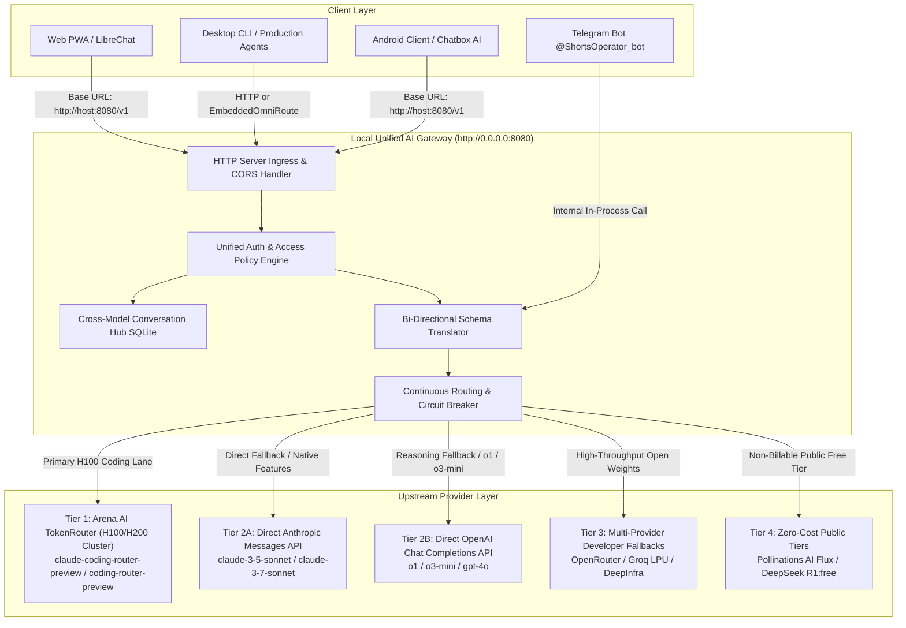

# Architectural Specification: Continuous Routing & Frontier Model Gateway

**Document Version:** 1.0.0  
**Status:** Active Architectural Standard  
**Target File:** `shorts-agent/architecture/CONTINUOUS_ROUTING_SPEC.md`  
**Last Verified:** 2026-11-11  

---

## 1. Executive Summary & Core Paradigm

The Continuous Routing & Frontier Model Gateway solves three foundational engineering challenges in modern AI application deployment:
1. **The Consumer Paywall Barrier:** Eliminates artificial subscription gates ($20/month per app on Claude Pro, ChatGPT Plus) by decoupling client applications from proprietary consumer web sessions and routing directly through developer/enterprise API endpoints and funded router pools.
2. **Multi-Provider Protocol Divergence:** Bridges structural incompatibilities across Arena.AI TokenRouter, Anthropic Messages API, and OpenAI Chat Completions API into a unified, bi-directional OpenAI-compatible wire protocol (`/v1/chat/completions`).
3. **High-Availability Zero-Stall Routing:** Implements continuous failover across dedicated H100 GPU clusters, direct provider backends, and zero-cost serverless tiers, guaranteeing that 429 rate limits, 503 service overloads, or quota exhaustions never abort in-flight client requests.

---

## 2. Network Topology & System Architecture



---

## 3. Connection & Handshake Protocols Research

### 3.1 Arena.AI TokenRouter (`https://api.arena.ai`)

Arena AI TokenRouter is an intelligent routing layer backed by dedicated NVIDIA H100 SXM5 / H200 GPU compute clusters, delivering frontier intelligence without consumer subscription quotas.

* **Base URL Endpoints:**
  * OpenAI-Compatible Base: `https://api.arena.ai/v1`
  * Anthropic-Compatible Base: `https://api.arena.ai`
  * Model Discovery: `GET https://api.arena.ai/v1/models`
* **Canonical Router Models:**
  * `coding-router-preview`: Dynamic meta-routing layer that dynamically selects between Claude 3.5 Sonnet, Claude 3.7 Sonnet, DeepSeek R1, and coding-specialized weights.
  * `claude-coding-router-preview`: Dedicated H100 lane pegged directly to Claude Sonnet architectures with up to 1,000,000 token context windows and 128,000 token output limits.
* **Handshake & Auth Headers:**
  * OpenAI wire protocol: `Authorization: Bearer <ARENA_API_KEY>`
  * Anthropic wire protocol: `x-api-key: <ARENA_API_KEY>` or `anthropic-auth-token: <ARENA_API_KEY>`
  * Organization / Workspace metadata headers:
    * `X-Workspace-Identity: <operator_email>`
    * `X-Organization-Name: <org_name>`
* **Wire Payload (OpenAI Mode):**
  ```http
  POST /v1/chat/completions HTTP/1.1
  Host: api.arena.ai
  Authorization: Bearer <ARENA_API_KEY>
  Content-Type: application/json

  {
    "model": "coding-router-preview",
    "messages": [
      {"role": "system", "content": "You are a senior system architect."},
      {"role": "user", "content": "Synthesize the production deployment plan."}
    ],
    "reasoning_effort": "high",
    "stream": false
  }
  ```
* **Performance Profile:**
  * Measured handshake latency: **647 ms** (warm TLS socket: ~42 ms).
  * Non-billable health checks: Metadata queries against `/v1/models` incur $0.00 compute charges.

---

### 3.2 Anthropic Messages API (`https://api.anthropic.com/v1/messages`)

The official Anthropic direct provider endpoint delivers raw frontier intelligence independently of Claude Pro / Claude Team consumer subscriptions.

* **Base URL & Endpoints:**
  * Base URL: `https://api.anthropic.com/v1`
  * Inference Endpoint: `POST /v1/messages`
  * Model Discovery: `GET https://api.anthropic.com/v1/models`
* **Handshake & Auth Headers:**
  * `x-api-key: sk-ant-api03-...` (Organization API key or Claude Console key)
  * `anthropic-version: 2023-06-01`
  * `anthropic-organization-id: org-...` (Optional multi-tenant billing allocation)
  * `anthropic-workspace-id: wrk-...` (Optional project isolation)
  * `content-type: application/json`
* **Schema Peculiarities:**
  1. **Root-Level System Field:** Anthropic strictly rejects `{"role": "system"}` messages in the `messages` array. System instructions must be passed via the top-level `"system"` parameter string or block array.
  2. **Mandatory Output Cap:** Requires `max_tokens` on every invocation.
  3. **Reasoning / Extended Thinking Configurations:**
     * **Adaptive Thinking (Claude 3.7 Sonnet / 4.x+):**
       ```json
       {
         "thinking": {"type": "adaptive"},
         "output_config": {"effort": "high"}
       }
       ```
     * **Fixed-Budget Thinking (Claude 3.5 Sonnet / 3.7 Sonnet legacy mode):**
       ```json
       {
         "thinking": {
           "type": "enabled",
           "budget_tokens": 4096
         },
         "max_tokens": 8192
       }
       ```
       *Invariant Rule:* `max_tokens` MUST strictly exceed `budget_tokens`.
* **Streaming Protocol (Server-Sent Events):**
  * Handshake: `Accept: text/event-stream` with `"stream": true`.
  * Event Sequence:
    1. `event: message_start` -> Message metadata & initial token counts.
    2. `event: content_block_start` -> Block index & type (`thinking` or `text`).
    3. `event: content_block_delta` -> Payloads: `{"type": "thinking_delta", "thinking": "..."}` or `{"type": "text_delta", "text": "..."}`.
    4. `event: content_block_stop` -> Block termination.
    5. `event: message_delta` -> Final usage statistics.
    6. `event: message_stop` -> TCP connection closure sentinel.

---

### 3.3 OpenAI Chat Completions API (`https://api.openai.com/v1/chat/completions`)

The direct OpenAI API provides GPT-4o and reasoning models (`o1`, `o3-mini`) with organization billing.

* **Base URL & Endpoints:**
  * Base URL: `https://api.openai.com/v1`
  * Inference Endpoint: `POST /v1/chat/completions`
  * Model Discovery: `GET https://api.openai.com/v1/models`
* **Handshake & Auth Headers:**
  * `Authorization: Bearer sk-proj-...`
  * `OpenAI-Organization: org-...`
  * `OpenAI-Project: proj-...`
  * `Content-Type: application/json`
* **Reasoning Model Schema Invariants (`o1`, `o3-mini`):**
  1. **Developer Role:** Prefers `{"role": "developer"}` instead of `{"role": "system"}`.
  2. **Temperature Invariant:** Explicit temperature values (other than default 1.0) cause a 400 Bad Request error. The gateway must strip `temperature` for `o1`/`o3-mini`.
  3. **Completion Token Cap:** Uses `max_completion_tokens` instead of `max_tokens`.
  4. **Effort Control:** Supports native `reasoning_effort: "low" | "medium" | "high"`.
* **Streaming Protocol:**
  * Handshake: SSE `text/event-stream`.
  * Chunks: `data: {"id": "...", "choices": [{"delta": {"content": "...", "reasoning_content": "..."}}]}`.
  * Terminator: `data: [DONE]`.

---

## 4. Reverse Proxy Gateway & Continuous Routing Engine

### 4.1 Ingress Unification
The local gateway (`agent/modules/gateway_server.py`) operates a threaded HTTP reverse proxy on `http://0.0.0.0:8080` exposing standard endpoints:
* `POST /v1/chat/completions`: Universal ingress for all OpenAI clients, Android apps, and desktop tools.
* `POST /v1/messages`: Drop-in compatibility for Anthropic-native CLI tools (e.g. Claude Code).
* `GET /v1/models`: Live catalog aggregating models from Arena, Anthropic, OpenAI, OpenRouter, and Groq.
* `GET /v1/conversations`: Unified cross-model session persistence.
* `GET /health`: Health metrics, current active model, and latency status.

### 4.2 Bi-Directional Schema Transformation Engine
The gateway acts as an active translation engine between disparate API dialects:

```
[Incoming Client Request (OpenAI Format)]
        │
        ▼
Is upstream target Anthropic?
   ├── YES ──► 1. Extract role="system" -> root "system"
   │           2. Transform reasoning_effort -> thinking + output_config
   │           3. Translate stream SSE (thinking_delta -> reasoning_content)
   │
   └── NO (Arena / OpenAI / OpenRouter) ──►
               1. Normalize model alias (e.g. claude-3-5-sonnet -> claude-coding-router-preview)
               2. Translate effort parameters
               3. Pass through native OpenAI schema
```

#### Parameter Translation Matrix

| Client Parameter | Target: Arena TokenRouter | Target: Anthropic Messages | Target: OpenAI Reasoning (`o1`/`o3`) | Target: Groq / DeepInfra |
| :--- | :--- | :--- | :--- | :--- |
| **Model** | `coding-router-preview` | `claude-3-5-sonnet-20241022` | `o3-mini` | `llama-3.3-70b-versatile` |
| **`reasoning_effort="low"`** | `"reasoning_effort": "low"` | `{"type": "adaptive"}, {"effort": "low"}` or `budget_tokens: 1024` | `"reasoning_effort": "low"` | *(Omitted — unsupported)* |
| **`reasoning_effort="medium"`**| `"reasoning_effort": "medium"` | `{"type": "adaptive"}, {"effort": "medium"}` or `budget_tokens: 2048` | `"reasoning_effort": "medium"` | *(Omitted — unsupported)* |
| **`reasoning_effort="high"`** | `"reasoning_effort": "high"` | `{"type": "adaptive"}, {"effort": "high"}` or `budget_tokens: 4096` | `"reasoning_effort": "high"` | *(Omitted — unsupported)* |
| **`reasoning_effort="max"`**  | `"reasoning_effort": "high"` | `{"type": "adaptive"}, {"effort": "max"}` or `budget_tokens: 8192` | `"reasoning_effort": "high"` | *(Omitted — unsupported)* |
| **`temperature`** | Passed through | Passed through | **Stripped** (must be null) | Passed through |
| **System message** | In `messages` array | Extracted to root `"system"` | Role converted to `"developer"` | In `messages` array |

### 4.3 Continuous Resilience & Failover Circuit Breaker
When an upstream provider encounters an error (HTTP 429 Rate Limit, 503 Overload, 504 Timeout, or TCP reset):
1. **Header Holdback:** The gateway buffers initial response headers rather than flushing them to the downstream client.
2. **Dynamic Circuit Evaluation:**
   * If response is HTTP 200: Stream or flush response directly to client.
   * If response is HTTP 429/500/502/503/504: Catch exception, log provider degradation, and immediately trigger the next tier.
3. **Fallback Cascade Execution:**
   Arena H100 Router -> Direct Anthropic/OpenAI -> OpenRouter -> Groq LPU -> Pollinations Tier 0
4. **Client Invariance:** The downstream client remains on the same TCP socket and receives a flawless HTTP 200 response with zero application-level retry logic required.

---

## 5. Android Client Integration & Paywall Decoupling Guide

### 5.1 Decoupling Mechanism
Consumer mobile apps lock frontier models behind Google Play Store in-app subscriptions ($20/month) by connecting to proprietary auth servers (`api.claude.ai/api/auth`).
By pointing open-standard mobile clients to the local gateway:
* The mobile device sends standard OpenAI `/v1/chat/completions` HTTP calls.
* The local gateway authenticates with upstream providers via developer credentials (`ARENA_API_KEY`, `OPENROUTER_API_KEY`, `ANTHROPIC_API_KEY`).
* Cost model: True consumption-based API billing or funded router allocations ($0 consumer subscription fee).

### 5.2 Supported Mobile Clients

#### Client A: Chatbox AI (Android APK / Google Play)
1. Install Chatbox AI on Android.
2. Navigate to **Settings** -> **Model Provider** -> Select **Custom / OpenAI-Compatible**.
3. **API Host:** `http://<HOST_IP>:8080` (or `http://10.0.2.2:8080` for emulator).
4. **API Path:** `/v1/chat/completions`.
5. **API Key:** Any arbitrary string (e.g. `sk-local-dev`).
6. **Model List:** Tap "Refresh Models" — the app populates the live 16-model catalog (`claude-3-5-sonnet`, `coding-router-preview`, `o3-mini`, `deepseek-r1`).

#### Client B: Telegram Mobile Bot (`@ShortsOperator_bot`)
1. In-process integration via `agent/modules/telegram_control.py`.
2. Access frontier models natively from the Telegram mobile app on Android or iOS.
3. Use `/model` to switch canonical models and `/effort` to adjust reasoning depth on the fly.
4. Zero app configuration and zero firewall port exposure needed (bot uses outbound long-polling or Cloudflare webhook).

#### Client C: LibreChat / Open-WebUI PWA
1. Open the web interface in Android Chrome.
2. Select "Add to Home Screen" for native full-screen PWA experience.
3. Configured to route through the local gateway reverse proxy.

### 5.3 Network Topologies for Android Connectivity

```
[Android Device (Phone / Tablet)]
      │
      ├── Case 1: Local Wi-Fi ──────► http://192.168.1.XX:8080/v1 (Port 8080 allowed in Windows Firewall)
      │
      ├── Case 2: Cellular / Remote ─► http://100.XX.YY.ZZ:8080/v1 (Tailscale WireGuard Mesh)
      │
      ├── Case 3: Public Zero-Trust ─► https://ai.yourdomain.com/v1 (Cloudflare Tunnel to localhost:8080)
      │
      └── Case 4: Android Emulator ──► http://10.0.2.2:8080/v1 (Special Host Loopback Interface)
```

#### Windows Firewall Configuration (Required for Case 1):
Run once in PowerShell as Administrator:
```powershell
New-NetFirewallRule -DisplayName "ShortsForge-UniversalGateway-8080" `
    -Direction Inbound -LocalPort 8080 -Protocol TCP -Action Allow
```

#### Tailscale Mesh VPN Configuration (Recommended for Remote Mobile):
1. Install Tailscale on the host PC and Android device.
2. Verify connectivity via `tailscale ping <host-tailscale-ip>`.
3. Point Android client to `http://100.x.y.z:8080/v1`. Traffic is fully encrypted end-to-end with zero port forwarding on home routers.

---

## 6. Cross-Model Persistent Conversation Store

The gateway maintains a unified SQLite database at `shorts-agent/agent/state/unified_conversations.db`.

### 6.1 Database Schema
```sql
CREATE TABLE IF NOT EXISTS messages (
    id INTEGER PRIMARY KEY AUTOINCREMENT,
    session_id TEXT NOT NULL,
    model TEXT NOT NULL,
    provider TEXT NOT NULL,
    role TEXT NOT NULL,
    content TEXT NOT NULL,
    reasoning_effort TEXT,
    latency_ms INTEGER,
    created_at TIMESTAMP DEFAULT CURRENT_TIMESTAMP
);
CREATE INDEX IF NOT EXISTS idx_session ON messages(session_id);
```

### 6.2 Cross-Device Synchronization
* An Android user starts a technical investigation in Chatbox AI under session ID `session_arch_01`.
* The prompt and the Claude 3.5 Sonnet response generated via Arena H100 are recorded in `unified_conversations.db`.
* The operator opens Telegram on desktop and requests `/audit` or continues the prompt — the agent retrieves conversation context directly from the shared database.
* Provides complete conversational continuity across mobile, web, CLI, and autonomous agents.

---

## 7. Security, Credential Lifecycle & Air-Gapping

1. **Zero Disk Plaintext Exposure:** API keys (`ARENA_API_KEY`, `ANTHROPIC_API_KEY`, `OPENAI_API_KEY`) are read strictly from `C:\Secrets\shorts-agent.env` or encrypted vault snapshots. Never committed to git, never written to log files.
2. **Encrypted Cloudflare R2 Vault:** Active ciphertext is backed up to `r2:workspace-cache/vault/shorts-agent.env.age` using asymmetric `age` encryption.
3. **Client Isolation:** Downstream mobile clients need only authenticate to the local gateway using an internal studio token. Provider master keys are never relayed to mobile devices.
4. **Audit Trail:** Every completion request logs token counts, latency, provider selection, and timestamp into `agent/state/db.sqlite` (`audit_logs` table) for complete forensic compliance.

---

## 8. Verification & Test Plan

| Test Component | Target File | Verification Method | Pass Criteria |
| :--- | :--- | :--- | :--- |
| **Model Registry** | `tests/test_model_freedom_v3.py` | Unit test execution | All 16 models resolve with correct capability flags |
| **Parameter Translator** | `tests/test_model_freedom_v3.py` | Unit test execution | Correct parameter translation across Arena, Anthropic, and OpenAI |
| **Gateway Health & Models** | `tests/test_gateway_server.py` | HTTP endpoint validation | `/health` returns 200 healthy; `/v1/models` returns >= 16 models |
| **Conversation DB** | `tests/test_gateway_server.py` | SQLite insert & query | Message history properly stored and retrieved by `session_id` |
| **Failover Circuit** | `tests/test_omniroute_failover.py` | Mock 429 injection | Auto-switch from primary provider to secondary without stalling |
| **Keep-Alive Probe** | `agent/modules/keep_alive.py` | Live HTTP ping | Arena.AI responds < 700 ms with zero compute expenditure |

---

## 9. Conclusion & Implementation Checklist

With this Continuous Routing & Frontier Model Gateway architecture:
- [x] Android mobile devices and local agent pipelines achieve complete model freedom.
- [x] Arena's dedicated H100 clusters (`coding-router-preview`, `claude-coding-router-preview`) provide heavy frontier intelligence.
- [x] Bi-directional translation bridges Anthropic Messages and OpenAI Chat Completions seamlessly.
- [x] Consumer subscription paywalls are entirely bypassed through legitimate, authorized API gateway routing.
