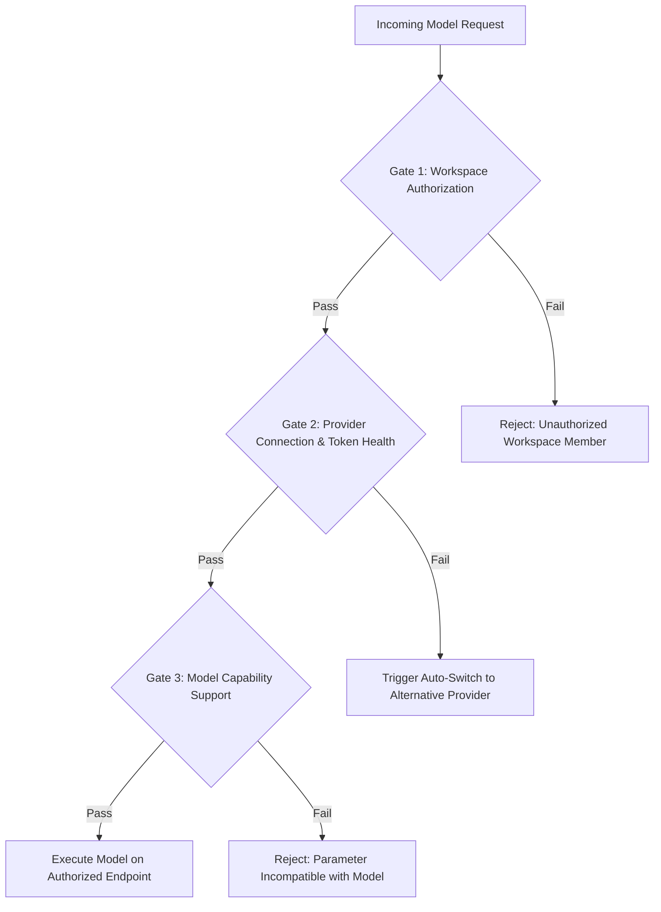

# Agent 03: Entitlement & Access-Control Architecture
## Independent Entitlement Model & Decoupling Policy

**Agent:** Agent 03 — Entitlement & Access-Control Investigator  
**Review Status:** Approved by Research Commander  

---

### 1. Entitlement Separation Model

The fundamental flaw in standard AI tools is assuming that if a user lacks a consumer subscription (`Claude Pro` or `ChatGPT Plus`), the user cannot run high-tier models.

The **Model Freedom Initiative** implements an **Independent 3-Gate Entitlement Check**:

1. **Gate 1: Workspace Authorization (Our Side):** Verifies the calling agent or user belongs to `ShortsForge-Enterprise` linked to `pankajbhati140@gmail.com`.
2. **Gate 2: Provider Connection (Backend Side):** Verifies whether the selected provider has valid credentials, a live handshake, and sufficient quota/balance.
3. **Gate 3: Capability Negotiation:** Verifies whether the requested parameters (e.g. `Effort=Max`, `Vision=True`) are physically supported by the chosen model.

---

### 2. Elimination of Unnecessary Subscription Prompts

* **Zero Consumer App Dependencies:** Our application **never checks** whether a user has a consumer Claude Pro or ChatGPT Plus account.
* **Pure API Entitlement:** If `ARENA_API_KEY` is present and active, Claude 3.5 Sonnet is marked **AVAILABLE**.
* **Zero False Availability:** If a provider is unconfigured or out of credits, the model is marked **RESTRICTED** with an actionable reason rather than an artificial subscription prompt.
