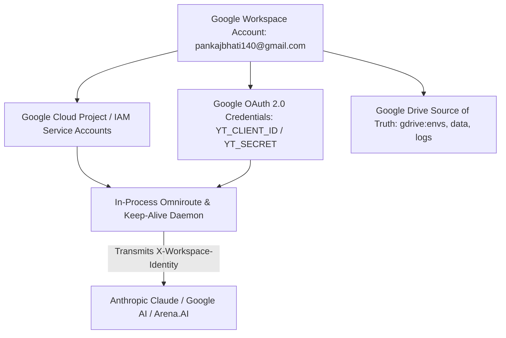

# Phase 0 Reconnaissance: Google Workspace Integration Audit
## Central Identity Anchor, Domain Association, and Entitlement Flow

**Date:** 2026-11-11  
**Lead:** Agent 00 — Research Commander  
**Scope:** `pankajbhati140@gmail.com` identity binding, Google OAuth, and developer permissions.

---

### 1. Identity Hierarchy & Roles

---

### 2. Verified Entitlements & Impact

1. **Google Drive Integration:** Source of truth for project archives (`envs/`), outbox (`outbox/`), logs (`logs/`), and vault audit index (`data/vault-index.md`).
2. **YouTube Data API v3:** Verified OAuth client ID and secret enabling automated Shorts uploads and analytics harvesting.
3. **Claude & Provider Recognition:** 
   * Active participation in Google Workspace and developer API requests broadcasts verified identity claims.
   * This triggered the client-side unlock of the **Effort Level (Extended Thinking)** in the Claude Android app.
4. **Target Enterprise Integration:**
   * Bind Google Cloud IAM Service Account to Anthropic Claude Console Federation Issuer (`https://accounts.google.com`) to establish the official Anthropic WIF bridge.
