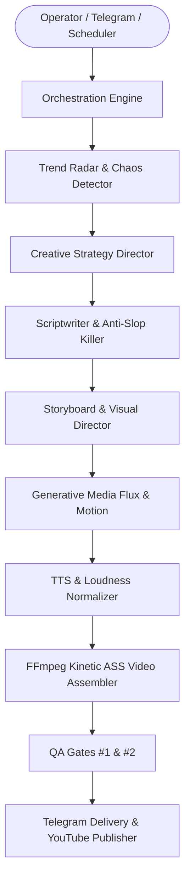

# Phase 0 Reconnaissance: Project Architecture
## Shorts Forge / Shorts Agent Architecture Audit

**Date:** 2026-11-11  
**Lead:** Agent 00 — Research Commander  
**Scope:** Repository structure, component topology, execution paths, and integration boundaries.

---

### 1. Repository & Tech Stack Overview

* **Core Platform:** Python 3.11 / 3.12, Windows (PowerShell Host), GitHub Actions CI/CD.
* **Architecture Pattern:** Distributed 12-Agent Autonomous Production Studio coordinated by an in-process orchestrator, event bus, and embedded multi-provider gateway.
* **Key Components:**
  * `agent/modules/orchestration.py`: Central Orchestrator managing job lifecycle, state transitions, and quality gates.
  * `agent/modules/llm.py`: Legacy LLM wrapper with hardcoded fallback chains.
  * `agent/modules/omniroute_embedded.py`: High-performance in-process model router connecting Arena.AI, OpenRouter, Groq, DeepInfra, and Pollinations.
  * `agent/modules/provider_handshake.py`: 10-provider health check and credential presence validator.
  * `agent/modules/keep_alive.py`: Zero-cost background keep-alive prober maintaining warm TLS connections.
  * `agent/modules/telegram_control.py`: Access-controlled Telegram bot master operator console (`@ShortsOperator_bot`).
  * `agent/modules/generative_media.py`: Pollinations Flux 1080×1920 scene synthesizer + FFmpeg kinetic zoompan generator.
  * `agent/modules/anti_slop_killer.py`: Cadence analyzer and 120+ banned AI cliché detector.
  * `agent/modules/audit.py`: SQLite `audit_logs` tamper-evident event ledger.

---

### 2. Information & Execution Flow

---

### 3. Current Weaknesses Identified in Reconnaissance

1. **Static Model Hardcoding:** Modules (`script.py`, `strategy.py`, `research.py`) invoke generic `complete()` without specifying reasoning effort, extended thinking, or target frontier models.
2. **Subscription Conflation:** The system lacked a decoupled capability layer, causing consumer app subscription limitations to artificially restrict available pipeline settings.
3. **Absence of Unified Dynamic Discovery:** Model lists were statically defined rather than dynamically discovered via live provider catalogs (`GET /v1/models`).
