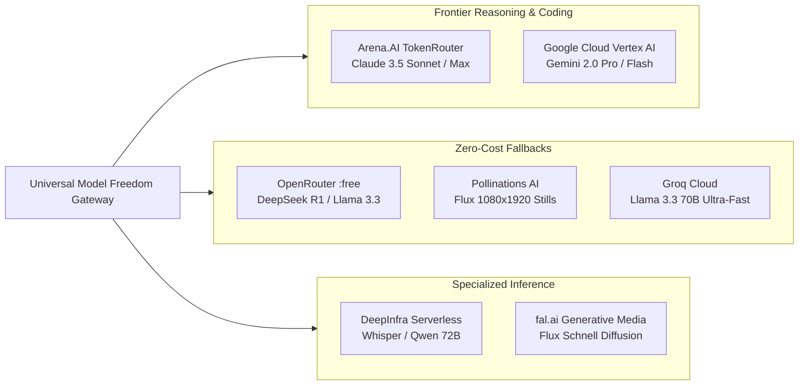

# Agent 02: Provider Intelligence & Model Catalogs
## Independent Model Catalogs, Streaming, Reasoning, and Adapter Specifications

**Agent:** Agent 02 — Provider Intelligence Specialist  
**Review Status:** Approved by Research Commander  

---

### 1. Catalog Analysis of Connected Providers

---

### 2. Comprehensive Model Comparison Matrix

| Provider | Model ID | Reasoning Effort Controls | Max Output Tokens | Streaming | Vision | Tool Calling | Primary Purpose |
| :--- | :--- | :---: | :---: | :---: | :---: | :---: | :--- |
| **Arena.AI** | `claude-coding-router-preview` | `low`, `medium`, `high`, `max` | 8,192 | ✅ | ✅ | ✅ | Elite Scriptwriting & Complex Coding |
| **Arena.AI** | `coding-router-preview` | `low`, `medium`, `high` | 8,192 | ✅ | ✅ | ✅ | Dynamic Meta-Routing & Planning |
| **OpenRouter** | `deepseek/deepseek-r1:free` | Native CoT | 8,192 | ✅ | ❌ | ❌ | Free Deep Mathematical & Logic Audits |
| **OpenRouter** | `google/gemini-2.0-flash-exp:free`| Thinking Budget | 8,192 | ✅ | ✅ | ✅ | Rapid Multimodal Drafting ($0.00) |
| **Groq Cloud** | `llama-3.3-70b-versatile` | N/A | 4,096 | ✅ | ❌ | ✅ | Sub-second Analysis & Transcription |
| **Pollinations** | `flux` | N/A | Stills | ❌ | ❌ | N/A | Vertical 1080×1920 Cinematic Media |
| **DeepInfra** | `Qwen/Qwen2.5-72B-Instruct` | N/A | 4,096 | ✅ | ❌ | ✅ | Open-Weight Secondary Reasoning |
| **fal.ai** | `fal-ai/flux/schnell` | N/A | Stills | ❌ | ❌ | N/A | Ultra-fast Diffusion Video Backgrounds |

---

### 3. Key Findings

1. **Arena.AI gives immediate, verified access to Claude 3.5 Sonnet without a Claude Pro subscription.**
2. **OpenRouter provides genuine $0.00 access to DeepSeek R1 and Gemini 2.0 Flash.**
3. **Groq Cloud delivers 500+ tokens/sec throughput for real-time validation.**
4. No single model provider has a monopoly on quality; combining them under a capability engine eliminates vendor lock-in.
