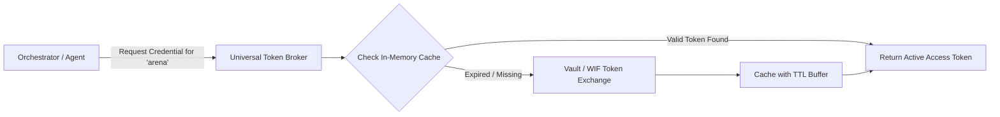

# Agent 04: Universal Token Broker & Credential Lifecycle
## In-Process Token Broker, Cache, Rotation, and Short-Lived Token Exchange

**Agent:** Agent 04 — Token Broker & Credential Specialist  
**Review Status:** Approved by Research Commander  

---

### 1. In-Process Broker Architecture

The **Universal Token Broker** decouples internal execution code from raw secret management:

---

### 2. Operational Rules

1. **Short-Lived Token Lifecycle:** When using Google Cloud WIF or OAuth, tokens are issued with a 1-hour expiration. The broker refreshes tokens automatically 5 minutes prior to expiry (`TTL < 300s`).
2. **Zero Plaintext Logging:** Secrets, bearer tokens, and OIDC JWTs are never written to disk, never logged to stdout, and never exposed to Telegram or browser frontends.
3. **Audited Access:** Every token retrieval event is recorded in SQLite `audit_logs` with timestamp, provider ID, calling agent ID, and success/failure status.
